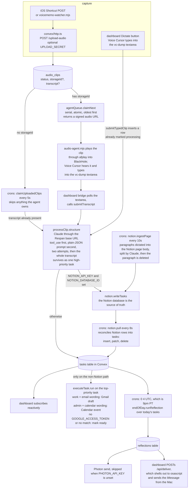

# Voice Cursor

Voice-first task assistant. This repo owns the **intelligence + delivery layer**:
transcript → structured tasks → execution → end-of-day reflection.

Audio capture and upload to `audio_clips` is the teammate's pipeline - we only read
from that table.

## Stack
- **Convex** - reactive backend, scheduled functions, tasks/reflections tables
- **Claude API** via the **Respan** gateway (observability)
- **Photon / Spectrum** - iMessage delivery for end-of-day reflection
- **Next.js 15 (App Router) + Tailwind** - live dashboard

## From clip to task

`audio_clips` is the seam. Rows land in it from the teammate's capture pipeline
or from this repo's own `/upload-audio` HTTP action, and everything below the
table is this repo. Which claimer picks a row up depends on one field: a clip
with a `storageId` belongs to the audio agent, a clip without one belongs to the
5-second cron.



The two branches out of `structure` are the thing to keep straight: with Notion
configured, tasks only reach Convex on the next `notion.pull` tick and
`executeTask` never fires. Without Notion, tasks are written to Convex directly
and the executor runs immediately.

## Setup

```bash
npm install
cp .env.example .env.local       # then fill in values
npx convex dev                   # in one terminal
npm run dev                      # in another
```

### Required environment variables
See `.env.example`. You will need:

- `CONVEX_DEPLOYMENT_URL` / `NEXT_PUBLIC_CONVEX_URL` - from teammate
- `ANTHROPIC_API_KEY` - used as the bearer token against the Respan gateway
- `RESPAN_API_KEY`, `RESPAN_BASE_URL` (default `https://api.respan.ai/v1`)
- `PHOTON_API_KEY`, `PHOTON_TARGET_NUMBER`

### Respan wiring
All Claude calls are issued to `RESPAN_BASE_URL` (not `api.anthropic.com`) with these
headers on every request:

- `X-Customer-Identifier: hackathon-demo`
- `X-Session-Id: <convex task id>`

This gives a full trace per structuring / reflection call in the Respan dashboard.

## What lives where

| File | Purpose |
| --- | --- |
| `convex/schema.ts` | `tasks`, `reflections` tables (+ read-only mirror of `audio_clips`) |
| `convex/queries.ts` | reactive queries the dashboard subscribes to |
| `convex/processClip.ts` | LLM structuring via Respan→Claude (retry once, raw fallback) |
| `convex/processClipMutations.ts` | mutations called by the action; public `submitTranscript` + `clipAwaitingTranscript` |
| `convex/executeTask.ts` | Gmail draft / Calendar event for top-priority task |
| `convex/endOfDay.ts` | reflection action + 5s tick to claim uploaded clips |
| `convex/crons.ts` | cron schedule (9pm reflection, 5s claim tick) |
| `app/page.tsx` | live dashboard + hidden `#vc-dump` textarea + bridge logic |

## Capture paths

Two ways to get audio into Convex from your phone - pick one or run both.

### A. iOS Shortcut → direct upload (fastest, recommended)

Build a Shortcut on iPhone:
1. **Record Audio** action - records on tap, stops on tap.
2. **Get Contents of URL** action:
   - URL: `https://<your-deployment>.convex.site/upload-audio`
     (i.e. `NEXT_PUBLIC_CONVEX_SITE_URL` + `/upload-audio`)
   - Method: POST
   - Request Body: **File** → "Recorded Audio"
   - Headers: `Content-Type: audio/m4a`
3. Optionally add `?key=<UPLOAD_SECRET>` to the URL if you want auth.
4. Add the Shortcut to your Lock Screen / Action Button / Back Tap.

Tap → speak → tap again → audio is in Convex within a second. The
`transcribeAudio` action fires immediately; the dashboard shows the new
clip in `processing` and tasks land seconds later.

### B. Voice Memos + iCloud sync → Mac watcher (zero phone code)

Use the stock Voice Memos app on iPhone. iCloud syncs the recording to the
Mac at `~/Library/Group Containers/group.com.apple.VoiceMemos.shared/Recordings/`.
The Mac watcher uploads it to Convex:

```bash
npm i -D chokidar       # one-time
npm run voicememo:watch
```

Slower than path A (iCloud sync takes 10–30s) but requires no phone setup.

### Downstream - both paths converge through the agent

1. Audio bytes land in Convex Storage; `audio_clips` row inserted with
   `status: "uploaded"`.
2. `npm run audio:agent` is a serial worker. `agentQueue.claimNext` atomically
   pulls the oldest uploaded clip, marks it `processing`, returns a signed URL.
3. Agent downloads + plays via `afplay` (set `VC_AUDIO_DEVICE="BlackHole 2ch"`
   to send to BlackHole specifically). Voice Cursor hears it, transcribes,
   types into the dashboard's `#vc-dump` textarea.
4. Dashboard bridge submits the transcript via `submitTranscript` mutation →
   schedules `processClip.structure`.
5. `processClip.structure` calls Claude via Respan → writes tasks → fires
   `notion.writeTasks` → fires `executeTask.run`.
6. Agent polls clip status; once `done`, claims the next clip.
7. 9pm cron → reflection → AppleScript iMessage to your phone.

## Audio agent (proactive Convex → Voice Cursor)

`scripts/audio-agent.mjs` is a long-running Node process that subscribes to
Convex (WebSocket, real-time) and reacts to new audio clips that have a
`storageId`. For each new clip it downloads the audio blob via a signed URL,
writes it to a temp file, and plays it with `afplay`. Combined with BlackHole
as macOS output, Voice Cursor hears it as mic input and transcribes into the
focused `#vc-dump` textarea.

This runs in parallel with Convex's Whisper transcription - you get both a
Voice Cursor transcript (via the textarea bridge) and a Whisper transcript
(server-side). Use whichever feels better.

```bash
npm run audio:agent
```

Set `VC_AUDIO_DEVICE="BlackHole 2ch"` to send audio to BlackHole specifically
without changing system output. Set `VC_DRY_RUN=1` to log new clips without
actually playing them (good for debugging the subscription).

## Voice Cursor quick-add (at the Mac)

The dashboard has a **Dictate** button (and Hammerspoon hotkey ⌘⇧V) that
exposes the `#vc-dump` textarea. Speak - Voice Cursor types into it - hit
Submit. The text is dropped straight into Convex as a typed clip, skipping
audio upload and Whisper. This is the fastest path when you're at your Mac.

## Hammerspoon integration

`hammerspoon/init.lua` provides:

- **⌘⇧V** - open the dashboard with `?dictate=1`, focus the textarea so
  Voice Cursor can type into it
- **⌘⇧T** - surface the current top open task as a native macOS notification
- Background poll every 60s against the Convex HTTP action `/top-task`;
  notifies on a new top task

Install:
```bash
brew install --cask hammerspoon
ln -s "$(pwd)/hammerspoon/init.lua" ~/.hammerspoon/init.lua
# then reload from the menu bar icon
```
Set `VC_DASHBOARD_URL` (default `http://localhost:3000`) and
`VC_CONVEX_SITE_URL` (from `NEXT_PUBLIC_CONVEX_SITE_URL`) in your shell rc
before launching Hammerspoon.

## iMessage delivery (AppleScript fallback)

If Photon isn't available, the dashboard delivers each new reflection via a
local Next.js route (`POST /api/deliver`) that shells out to
`osascript`. First run will prompt macOS to grant Messages.app automation
permission. Target number set via `IMESSAGE_TARGET_NUMBER` (server) and
`NEXT_PUBLIC_IMESSAGE_TARGET_NUMBER` (browser).

## Pipeline flow

1. Teammate writes `audio_clips` row with `status: "uploaded"`.
2. `crons.ts` 5-second tick claims it → `status: "processing"`.
3. Dashboard reactively sees a `processing` clip with no transcript, polls
   `#vc-dump` every 500ms for up to 30s, then calls `submitTranscript`.
4. `submitTranscript` schedules `processClip.structure` (Claude via Respan).
5. Structuring writes a `tasks` row, marks the clip `done`, schedules `executeTask.run`.
6. Executor inspects top-priority task; drafts an email or creates a calendar
   event if the intent matches; otherwise marks `ready`.
7. 9pm cron pulls today's tasks, generates a reflection, posts it to Photon.

## Google APIs

Executor calls Gmail / Calendar REST endpoints directly with
`Authorization: Bearer $GOOGLE_ACCESS_TOKEN`. For the hackathon, mint a token
via the OAuth Playground with the `gmail.compose` and `calendar.events` scopes
and drop it in `.env.local` as `GOOGLE_ACCESS_TOKEN`. If unset, the executor
falls back to marking the task `ready` with a note.

## Deploying it

Only the Convex half deploys. The Mac half cannot.

```bash
npm run convex:deploy          # convex deploy
```

That pushes the schema, the four crons, and the HTTP router to a Convex
production deployment. Once it lands, `https://<deployment>.convex.site/upload-audio`
is a real endpoint the iOS Shortcut can POST to, and the crons run on Convex's
clock rather than on your laptop.

`.env.local` is only read by the Next.js side. Every variable the Convex
functions read has to be set on the deployment itself:

```bash
npx convex env set ANTHROPIC_API_KEY ...
npx convex env set RESPAN_BASE_URL ...
npx convex env set NOTION_API_KEY ...
npx convex env set NOTION_DATABASE_ID ...
npx convex env set NOTION_PAGE_ID ...        # only for the ingestPage cron
npx convex env set PHOTON_API_KEY ...
npx convex env set PHOTON_TARGET_NUMBER ...
npx convex env set GOOGLE_ACCESS_TOKEN ...
npx convex env set UPLOAD_SECRET ...         # optional, gates /upload-audio
```

The dashboard is a plain `next build` / `next start`, but hosting it off a Mac
breaks two things on purpose:

- `/api/deliver` shells out to `osascript` against Messages.app, so iMessage
  delivery only works on a Mac that is signed in to iMessage.
- The vc-dump bridge assumes Voice Cursor is running on the same machine and
  typing into the browser, so the audio transcript path needs that machine too.

`scripts/audio-agent.mjs`, `scripts/voicememo-watcher.mjs` and the Hammerspoon
config are local processes by design and have no deploy target.

## Status
- [x] Schema (tasks + reflections)
- [x] Next.js dashboard + #vc-dump bridge
- [x] `processClip` action (LLM structuring through Respan)
- [x] `executeTask` action (Gmail / Calendar via Google APIs)
- [x] End-of-day reflection cron + Photon delivery
